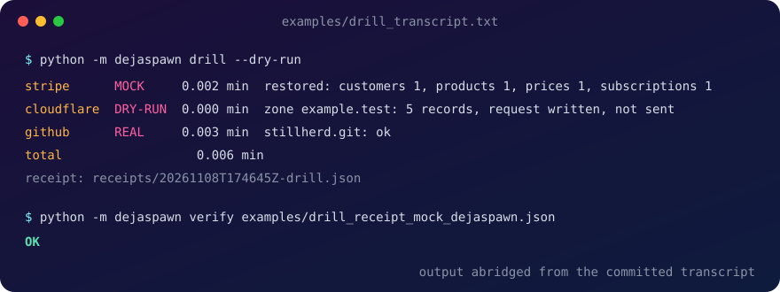

<p align="center">
  
</p>

<h1 align="center">Deja Spawn: rehearse losing your accounts</h1>

<p align="center">
  <b>You've been here before.</b><br>
  Rehearse losing your Stripe, Cloudflare and GitHub accounts, so that when it happens for real, it's a re-run.
</p>

<p align="center">
  
</p>

<p align="center">
  <a href="#2-quick-start">Quick start</a> · <a href="#3-what-it-mirrors-and-drills">How it works</a> · <a href="#8-evidence">Evidence</a> · <a href="#faq">FAQ</a>
</p>

<p align="center"><code>python -m dejaspawn drill --dry-run</code></p>

<p align="center">
  
</p>

<table align="center">
  <tr>
    <td align="center"><h3>3</h3><sub>platforms mirrored<br>into files you own</sub></td>
    <td align="center"><h3>0.006 min</h3><sub>timed drill on one real setup<br>(mock / dry-run targets)</sub></td>
    <td align="center"><h3>1 byte</h3><sub>changed in a mirror<br>turns <code>verify</code> into FAIL</sub></td>
    <td align="center"><h3>DSSE</h3><sub>in-toto attestations,<br>pinned-keyid verify</sub></td>
  </tr>
</table>

---

## Contents

1. [Why](#1-why)
2. [Quick start](#2-quick-start)
3. [What it mirrors and drills](#3-what-it-mirrors-and-drills)
4. [Receipts](#4-receipts)
5. [Environment](#5-environment)
6. [What it does not protect](#6-what-it-does-not-protect)
7. [Scope and limits](#7-scope-and-limits)
8. [Evidence](#8-evidence)

---

## 1. Why

Accounts get suspended. Payment processors freeze. Repos vanish behind a policy email. When it happens, the question is not "do we have a backup?" but **"how many minutes until we're live again?"**

Deja Spawn answers that before it matters: it **mirrors** what you run on, **drills** the restore against safe targets and times it, and **proves** each run with a signed receipt. Per-platform backup tools exist; this is one owner-kept mirror across platforms, with a rehearsed restore you can verify.

## 2. Quick start

```bash
docker run -d -p 12111:12111 stripe/stripe-mock      # safe restore target for Stripe
python -m dejaspawn doctor                           # PASS/FAIL: Docker, stripe-mock, git, signing key
python -m dejaspawn mirror stripe
python -m dejaspawn mirror cloudflare
python -m dejaspawn mirror github --repo owner/name
python -m dejaspawn drill --dry-run                  # minutes to recovery, per platform
python -m dejaspawn verify receipts/<latest>.json.dsse.json   # OK, or FAIL if anything changed
```

## 3. What it mirrors and drills

| Platform | Mirror | Drill |
|---|---|---|
| **Stripe** | customers, subscriptions, products, prices, invoices (last 90 days) → `mirror/stripe/<run id>/*.jsonl` | recreates customers, products, prices and subscriptions into stripe-mock |
| **Cloudflare** | every DNS zone export → `mirror/cloudflare/<run id>/<zone>.txt` | re-imports each zone through the real import function; `--dry-run` writes the exact request to `scratch/` |
| **GitHub** | `git clone --mirror` of one repo (`--repo owner/name`) or, with `GITHUB_TOKEN`, every repo you own, collaborate on or reach through an organisation, plus issues and PRs as JSON | `git fsck` on every mirror |

A drill never touches a live account unless you ask it to. Stripe refuses any non-local restore target unless `DEJASPAWN_ALLOW_REAL_RESTORE=1`, and it refuses a live key unless `DEJASPAWN_ALLOW_LIVE=1`.

## 4. Receipts

Every command ends with `receipts/<time>-<command>.json` (the legacy-format file) and its DSSE envelope. The `.json` lists the files written (with record counts and sha256), the elapsed seconds, and a mode for each platform:

| Mode | Meaning |
|---|---|
| `REAL` | live API |
| `MOCK` | local mock server |
| `FIXTURE` | built-in sample data |
| `DRY-RUN` | request built, not sent |
| `NO-MIRROR`, `MOCK-UNAVAILABLE` | that platform was **not** rehearsed |

Each run also writes `<receipt>.json.dsse.json`: a standard **DSSE envelope over an in-toto Statement v1**, whose subjects are the mirrored files and their sha256. That means generic supply-chain tooling can read it, not just this one. The predicateType is `https://ripplarity.com/attestation/dejaspawn/mirror/v1`. Envelopes are signed with ed25519; the key is created on first use at `~/.dejaspawn/dejaspawn_ed25519.pem` (override with `DEJASPAWN_KEY`).

`verify` checks the signature against a **pinned keyid**: either your local signing key file (the output prints which source set the keyid), or `--key HEX --expect-keyid ID` given out of band. `--key` without `--expect-keyid` is refused, and so is a signing key file that sits next to the artefact. It also checks that every mirrored file named in the statement still matches its hash; files that are not on disk are reported, with the signature still confirmed.

> A FIXTURE or MOCK receipt is not evidence that your real data is safe.

<details>
<summary><b>Receipt and key details</b></summary>

- Key lookup: `DEJASPAWN_KEY` if set, otherwise `~/.dejaspawn/dejaspawn_ed25519.pem` (created on first use).
- Rotation: generate a new key at the first path, keep the old file until old attestations are re-verified with `--key`, publish the new keyid, then delete the old key.
- Each run also writes a plain `.json` receipt (version id `dejaspawn-receipt-1`); `verify` accepts it and labels it `legacy format`. They hold their own public key, so that check shows integrity, not who signed.
- `drill` exits 0 even when a platform is `NO-MIRROR` or `MOCK-UNAVAILABLE`. Read the mode, not the exit code.

</details>

## 5. Environment

| Variable | Use |
|---|---|
| `STRIPE_API_KEY` | test-mode key (`sk_test_`/`rk_test_`). With a test key set and no `STRIPE_API_BASE`, the target is the REAL Stripe API (`https://api.stripe.com`, label REAL-TEST); the stripe-mock default (`http://localhost:12111`) applies only when no key is set. Live keys are refused unless `DEJASPAWN_ALLOW_LIVE=1`. |
| `DEJASPAWN_STRIPE_RESTORE_BASE`, `STRIPE_RESTORE_KEY` | restore target and its key (default: stripe-mock) |
| `DEJASPAWN_ALLOW_LIVE`, `DEJASPAWN_ALLOW_REAL_RESTORE` | set to `1` to allow a live key, or a non-local restore target |
| `DEJASPAWN_KEY` | path of the signing key |
| `CF_API_TOKEN` | zone and DNS read access; edit access only for a real restore |
| `GITHUB_TOKEN` | optional for `--repo` on public repos |

API keys and tokens passed by environment variable are never logged or written to disk. The GitHub token reaches git through the environment, not the command line or the repo config. One exception, by necessity of OAuth: the Workspace mirror stores the Google refresh token at `~/.dejaspawn/workspace_token.json` (mode 600 on POSIX; Windows ACLs are not changed, so protect that folder yourself). Revoke it at any time at https://myaccount.google.com/permissions (remove the app) and delete the file.

## 6. What it does not protect

- **Anything the platform never exposes:** card numbers and payment methods (Stripe: not available via the API; card data moves only by a Stripe-mediated transfer to another PCI DSS Level 1 processor (see docs.stripe.com/get-started/data-migrations/pan-export), so a self-serve restore cannot recreate payment methods), secrets, webhook signing keys and Radar rules.
- **Stripe:** a restore recreates objects with new ids. Payment methods are **UNRECOVERABLE**: not available via the API; card data moves only by a Stripe-mediated transfer to another PCI DSS Level 1 processor (see docs.stripe.com/get-started/data-migrations/pan-export), so a self-serve restore cannot recreate payment methods, and the drill never fabricates one. A subscription recreates cleanly only if it was trialing with a future `trial_end` (sent as `trial_end` with `payment_behavior=default_incomplete`); otherwise Stripe returns status `incomplete`, recorded per subscription as `restored_status`. Invoice history is mirrored but not re-created.
- **Cloudflare:** DNS records only. Not Workers, Pages, rules or certificates.
- **GitHub:** repositories, issues and PRs. Not Actions secrets, wikis, release assets or review comments.
- **Google Workspace:** step 1 is read-only (Gmail raw messages, Drive files). There is no restore; the drill only verifies manifest hashes and counts (VERIFY-ONLY). Drive items without an export format, and Google-native types beyond Docs, Sheets and Slides, are skipped.

## 7. Scope and limits

- Exercised so far: Stripe against stripe-mock and a sandbox, Cloudflare DNS-read on one real account, and GitHub against one public repo. A private GitHub repo with a token has not been exercised.
- stripe-mock returns one static object per list, so multi-page pagination is untested.
- The 0.006 min drill restored into stripe-mock and did not send the Cloudflare import. Real minutes-to-recovery will be dominated by re-authenticating to new accounts, which the drill does not measure yet.
- A mirror on the same machine and account as the original is a copy, not a safeguard. Keep `mirror/` somewhere the platforms cannot reach.

## 8. Evidence

- The full transcript is in `examples/drill_transcript.txt`.
- Signed examples: `examples/drill_attestation_mock.dsse.json` (current DSSE format, from a mock drill) and, in the legacy format, `examples/drill_receipt_mock_dejaspawn.json`.
- The mirrored files named as subjects in the DSSE example are not in the repository, so `verify` reports them as not on disk while still confirming the signature.

```bash
python -m dejaspawn verify examples/drill_receipt_mock_dejaspawn.json   # OK (legacy format)
python -m dejaspawn verify examples/drill_attestation_mock.dsse.json \
  --key 13b0904b0f53a56cc785e2b0aeff48794b3b5727e23169f56c9026255ca58587 \
  --expect-keyid e7606d656411c28130854a23473c47d4e3799ebae67f5ba5fc0f11fc0c17e38c   # OK
```

## 9. Respawn card, schedule, Workspace, Exit Score

- **Card:** `python -m dejaspawn drill --card` runs the drill and writes `cards/<date>.md` and `.txt`: per platform what came back, minutes to recovery, what is unrecoverable by design, the drill mode (MOCK, DRY-RUN or REAL), and the attestation file and keyid. Pass `--dry-run` to skip the DNS import.
- **Exit codes and PARTIAL:** a drill always writes a receipt and card. Each object is attempted on its own and recorded as `created` or `failed: <reason class>`; if any object failed the drill status is PARTIAL and the exit code is 3 (0 = full, 1 = hard error such as a GitHub or Workspace check failing). The card lists a created/failed table per type and the line "Unrecoverable by design" for payment methods.
- **Schedule:** `python -m dejaspawn drill --schedule monthly|weekly` installs a Windows Scheduled Task (`schtasks`) or a cron line, named `dejaspawn-drill`, that runs `drill --card --dry-run` from the current directory. `--unschedule` removes it. Add `--dry-run` to either to print the task or cron line without installing.
- **Workspace mirror:** `python -m dejaspawn mirror workspace` reads Gmail (`messages.list`, `messages.get` format raw, scope `gmail.readonly`) and Drive (`files.list`, `files.export`/`get`, scope `drive.readonly`) into `mirror/workspace/<account-hash>/` with `manifest.json` (sha256 per file). Set `GOOGLE_OAUTH_CLIENT_JSON` to an installed-app client file; the token is cached only under `~/.dejaspawn/`. Re-runs are incremental (Gmail by historyId, Drive by modifiedTime). Without the client file it runs in FIXTURE mode on synthetic data and says so. Implementation: `dejaspawn/workspace.py`. The real path has not been exercised against a live account.
- **Exit Score:** `python -m dejaspawn exitscore` prints, per platform, the share of the state classes it holds (customers, subscriptions, payment instruments, invoices, DNS, certs, code, issues, mail, files, secrets) that its documented export surface lets you take out (full = 1, partial = 0.5, none = 0), next to the latest drill mode, and writes `exitscore.json`. It is derived from vendor documentation, not measured against any vendor; every row carries its source URL, held in the table in `dejaspawn/exitscore.py`. The state classes with no or partial self-serve export are listed with their routes in [UNEXPORTABLE.md](UNEXPORTABLE.md). All URLs were fetched and read on 2026-11-08 (HTTP 200). One row, Cloudflare certificates, is marked UNVERIFIED because its page does not state what can be exported; it is excluded from that platform's score. `python -m dejaspawn exitscore --check-sources` re-fetches every URL and prints reachable or unreachable per row.

- **Evidence pack:** `python -m dejaspawn evidence [--run <id>]` writes `evidence/<UTC date>/` from the latest (or given) drill: the respawn card (md and txt), the drill and mirror attestations it relies on, a copy of `attest_verify.py` with the public key and pinned keyid, `verify.sh` / `verify.cmd`, `CONTROL_MAP.md` (references by ID only to SOC 2 A1.2 / CC9 and ISO/IEC 27001:2022 Annex A 8.13, plus short quotes of EU DORA articles 11, 12, 24 and 28), a pack `README.md`, and `MANIFEST.json` (sha256 of every file) wrapped in a DSSE attestation with predicateType `https://ripplarity.com/attestation/dejaspawn/evidence/v1`. An auditor verifies offline with `KEYID=<keyid obtained out of band> sh verify.sh`; without `KEYID` the script exits 2 and never trusts the keyid shipped in the pack. It describes a drill; it is not an auditor opinion, and the drill mode (sandbox or live) is stated in the pack.

- **Snapshots:** every `mirror <platform>` run writes into its own immutable directory `mirror/<platform>/<UTC run id>/` (for example `20261108T221657Z`) and then updates the plain-text pointer file `mirror/<platform>/latest` (not a symlink, so it works on Windows) with that run id. Attestation subjects use the snapshot paths, so an older attestation keeps passing `verify` (subject check) on the same machine after a re-mirror. `drill` reads `latest`; `drill --run <id>` drills that snapshot (a platform without that id shows NO-MIRROR). A legacy flat layout (`mirror/<platform>/*.jsonl` and so on) is moved into a snapshot named `legacy-<mtime>` the first time it is seen and `latest` points at it; receipts signed before this change name the old flat paths and report "not on disk (signature still valid)". Workspace and GitHub snapshots start from a copy of the previous one so re-runs stay incremental.
- **Prune:** `python -m dejaspawn mirror prune --keep N` keeps the newest N snapshots per platform and deletes older ones, except it never deletes the snapshot `latest` names, nor any snapshot that a receipt under `receipts/` references (those receipts were written after the snapshot, and deleting it would break their `--check-subjects` style file check). Delete the receipt first if you really want that snapshot gone.

## FAQ

**Will a drill touch my live accounts?**
No. Stripe restores go into stripe-mock, and Cloudflare imports are written to `scratch/` with `--dry-run`. A live target needs `DEJASPAWN_ALLOW_REAL_RESTORE=1`, and a live Stripe key needs `DEJASPAWN_ALLOW_LIVE=1`.

**Where do my mirrors live?**
In `mirror/`, `receipts/` and `scratch/` on your machine, all gitignored. Copy `mirror/` somewhere the platforms cannot reach: a copy on the same account is not a safeguard.

**Can it bring back card details or secrets?**
Not card details: not available via the API; card data moves only by a Stripe-mediated transfer to another PCI DSS Level 1 processor (see docs.stripe.com/get-started/data-migrations/pan-export), so a self-serve restore cannot recreate payment methods. Secrets are not exported by the platforms either, so both are listed as unrecoverable by design. Plan to re-collect payment methods and rotate secrets.

**What does it cost?**
Nothing. It runs locally under Apache-2.0, needs only Python, `cryptography` and `git`, and makes no calls except to the platforms you mirror, plus the documentation URLs fetched when you explicitly run `exitscore --check-sources`.

**My receipt says `NO-MIRROR` or `MOCK-UNAVAILABLE`. Did it pass?**
That platform was not rehearsed. `drill` still exits 0, so read the mode, not the exit code.

**How does this relate to Stillherd?**
Stillherd protects the execution of work; Deja Spawn protects the systems behind it. Both sign their records in the same attestation format, verified by the same byte-identical verifier ([ripplarity/stillherd](https://github.com/ripplarity/stillherd)).

---

<p align="center"><sub>Apache-2.0 · Copyright 2026 Ripplarity Inc.</sub></p>
